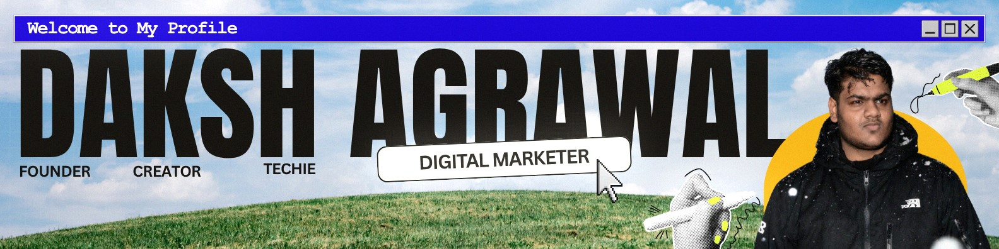
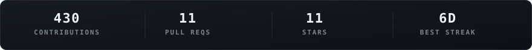
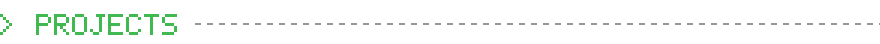
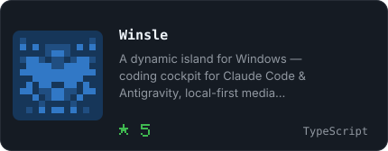
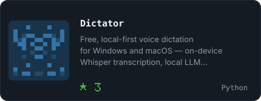

<!-- Pixel Studio Animated Room Screen -->

The monitor scrolls my latest commits; the shelf holds a book for each language I write.

 

Daksh — "skilled, capable." My parents named me that before I had to earn it. Still working on it.

I run Uideas — video editing, motion graphics, brand identity, and web dev, mostly for creators and small brands who need content that doesn't look like everyone else's. No team behind me, so I've picked up scripting, production pipelines, and enough code to build the tools an agency my size usually can't afford. Grew [@uideasofficial](https://instagram.com/uideasofficial) to 50K+ followers doing exactly this.

This GitHub is the other half — where the "backend" work lives. I'm not a trained engineer, I learn by breaking things until they work, then breaking them again on purpose to see why. Most of what's here started as "I needed this for the studio and didn't want to depend on someone else's cloud tool for it." Local-first by default, not because I'm dogmatic about it, but because it's usually the harder and more interesting way to build something.

If you're into either side of this — the content or the tools — that's the kind of work I actually enjoy.

 

  

<!-- Real GitHub Statistics HUD -->

 

<!-- Live GitHub Streak & Contributions -->

  

<!-- Projects Section -->
 PROJECTS" />

<table border="0" style="width:100%; border:none; background:transparent;">
  <tr>
    <td width="50%" style="border:none; padding:0 8px 0 0;">
      
    </td>
    <td width="50%" style="border:none; padding:0 0 0 8px;">
      
    </td>
  </tr>
</table>

  

<!-- Dynamic Solar System of Public Repositories (Auto-updates with repos as planets & comets as recent pushes) -->

Solar System · Planets represent public repositories, comets represent recent pushes

  

